# SpaceBooking

Ứng dụng web nội bộ để đặt phòng họp theo khung giờ, **không bao giờ trùng lịch**, kể cả khi nhiều người bấm đặt cùng lúc.

- **3 vai trò:** EMPLOYEE (nhân viên), MANAGER (quản lý), ADMIN (quản trị viên).
- **Backend:** Java 21, Spring Boot 3.5, PostgreSQL 16, JWT, Caffeine, Flyway.
- **Frontend:** Angular 21 (standalone), TailwindCSS 4, giao diện tiếng Việt, responsive (timeline trên desktop, thẻ trên mobile).
- **Chất lượng:** contract-first (OpenAPI đóng băng), 96.2% line coverage backend, E2E Playwright + axe, CI GitHub Actions.

## Mục lục
1. [Tính năng theo vai trò](#1-tính-năng-theo-vai-trò)
2. [Kiến trúc hệ thống](#2-kiến-trúc-hệ-thống)
3. [Cơ sở dữ liệu (ERD)](#3-cơ-sở-dữ-liệu-erd)
4. [Vòng đời booking (State machine)](#4-vòng-đời-booking-state-machine)
5. [Quy tắc nghiệp vụ](#5-quy-tắc-nghiệp-vụ)
6. [Chống đặt trùng đồng thời](#6-chống-đặt-trùng-đồng-thời)
7. [Sự kiện, audit log và cache](#7-sự-kiện-audit-log-và-cache)
8. [Tác vụ nền (Scheduler)](#8-tác-vụ-nền-scheduler)
9. [Bảo mật và phân quyền](#9-bảo-mật-và-phân-quyền)
10. [REST API](#10-rest-api)
11. [Frontend](#11-frontend)
12. [Kiểm thử](#12-kiểm-thử)
13. [Chạy dự án ở máy local](#13-chạy-dự-án-ở-máy-local)
14. [Triển khai (Neon + Render + Vercel)](#14-triển-khai-neon--render--vercel)
15. [Cấu trúc thư mục và tài liệu](#15-cấu-trúc-thư-mục-và-tài-liệu)

---

## 1. Tính năng theo vai trò

| Vai trò | Được làm gì |
|---|---|
| **EMPLOYEE** | Xem lịch toàn công ty, tìm phòng theo sức chứa, thiết bị, khung giờ trống. Đặt phòng tối đa **2 giờ/lần**; phòng có `requires_approval` sẽ ở trạng thái **chờ duyệt**. Check-in, trả phòng sớm, hủy lịch của chính mình. |
| **MANAGER** | Mọi quyền của EMPLOYEE, **không giới hạn thời lượng**, đặt phòng nào cũng **tự động được duyệt**. Duyệt hoặc từ chối (kèm lý do) yêu cầu của nhân viên. |
| **ADMIN** | Quản lý danh mục phòng (thêm, sửa, vô hiệu hóa, cấu hình thiết bị) và tra cứu toàn bộ nhật ký kiểm toán. ADMIN **không** đặt phòng. |

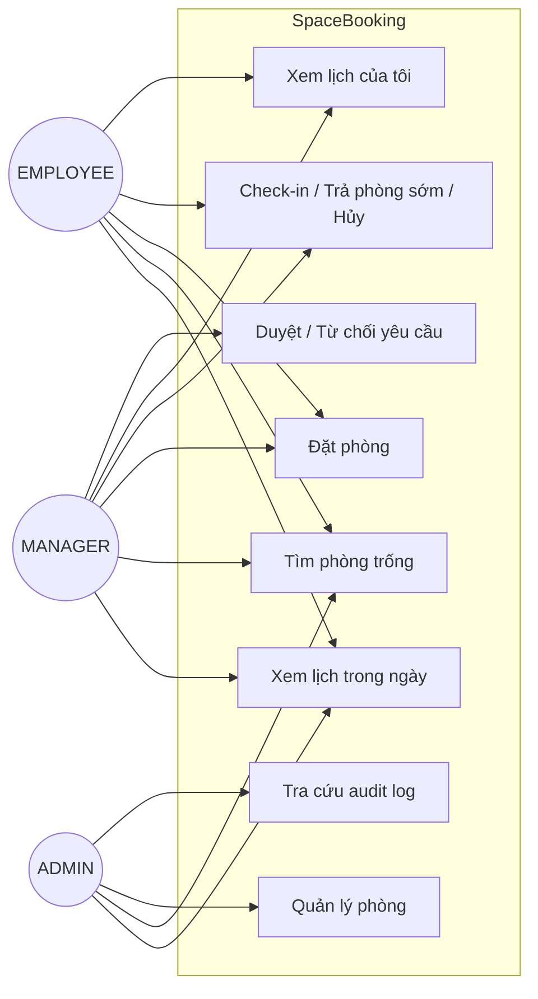

## 2. Kiến trúc hệ thống

### 2.1 Tổng quan triển khai

**Modular monolith**: một backend Spring Boot duy nhất, chia module theo nghiệp vụ. Lựa chọn này giữ được giao dịch ACID cho việc đặt phòng mà không cần distributed transaction (Saga), không tốn độ trễ mạng nội bộ, và vẫn tách bạch các module để sau này dễ tách ra nếu cần.

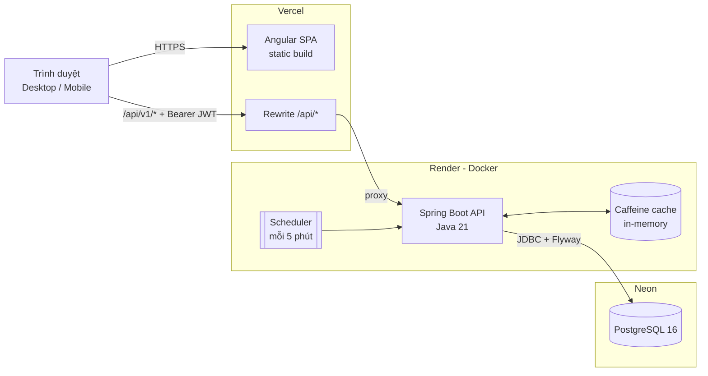

Frontend gọi đường dẫn tương đối `/api/v1`; Vercel rewrite chuyển tiếp sang Render, nên frontend không cần biến môi trường nào. Ở máy local, `proxy.conf.json` của Angular chuyển `/api` sang `http://localhost:8080`.

### 2.2 Kiến trúc backend

Package-by-feature `com.spacebooking.<feature>`, mỗi feature chia tầng `api` (controller, DTO) → `service` (giao dịch, điều phối) → `domain` (luật nghiệp vụ thuần) → `infra` (repository JPA).

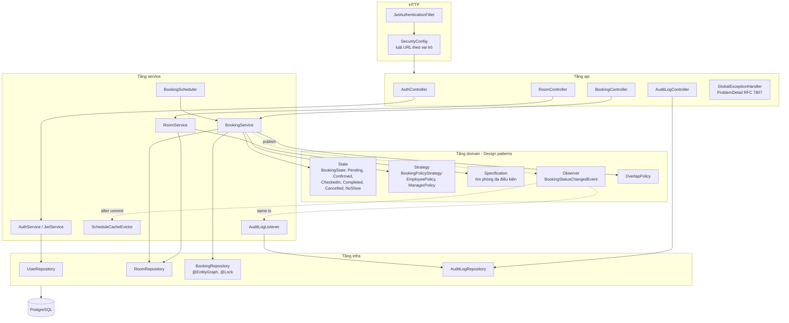

| Package | Trách nhiệm |
|---|---|
| `auth` | Đăng ký, đăng nhập, `/auth/me`, phát và kiểm tra JWT HS256 |
| `security` | `JwtAuthenticationFilter`, luật phân quyền theo URL, trả 401/403 dạng ProblemDetail |
| `room` | CRUD phòng, soft delete, tìm phòng bằng JPA Specification |
| `booking` | Tạo booking, State machine, Strategy theo vai trò, khóa, scheduler, cache lịch ngày |
| `audit` | Ghi audit log qua event listener, API tra cứu |
| `user` | Entity và repository người dùng |
| `common` | `ErrorCode`, `ApiException`, `GlobalExceptionHandler` |
| `config` | Cache, `Clock` (inject để test được thời gian), CORS, scheduling, OpenAPI |
| `seed` | `DataSeeder`: 3 tài khoản demo + 5 phòng mẫu |
| `testsupport` | Chỉ có ở profile `e2e`: reset dữ liệu, chỉnh đồng hồ, chạy scheduler |

### 2.3 Lý do chọn công nghệ

| Hạng mục | Chọn | Thay vì | Vì sao |
|---|---|---|---|
| Kiến trúc | Modular monolith | Microservices | Cần ACID chặt chẽ, đội nhỏ, hạ tầng miễn phí |
| Backend | Java 21 + Spring Boot | Node.js | Kiểu tĩnh cho State/Strategy, ProblemDetail có sẵn |
| Khóa | Optimistic (`@Version` trên room) + exclusion constraint | `synchronized`, pessimistic trên room | `synchronized` chỉ khóa một JVM; khóa cứng room làm nghẽn luồng đọc |
| Cache | Caffeine | Redis | Single instance, không tốn network round-trip, có TTL và `maximumSize` |
| Sự kiện | Spring Application Events | Kafka / RabbitMQ | Tách audit khỏi luồng chính mà không cần message broker |
| Frontend | Angular + Tailwind | React / Vue | Bộ công cụ đồng bộ (Reactive Forms, Interceptor, Guard), hợp tư duy OOP |
| Schema | Flyway + `ddl-auto=validate` | Hibernate tự sinh | Schema được kiểm soát, Hibernate chỉ kiểm tra khớp |

## 3. Cơ sở dữ liệu (ERD)

4 bảng PostgreSQL. Thời gian lưu dạng UTC; ranh giới ngày tính theo `Asia/Ho_Chi_Minh` (UTC+7).

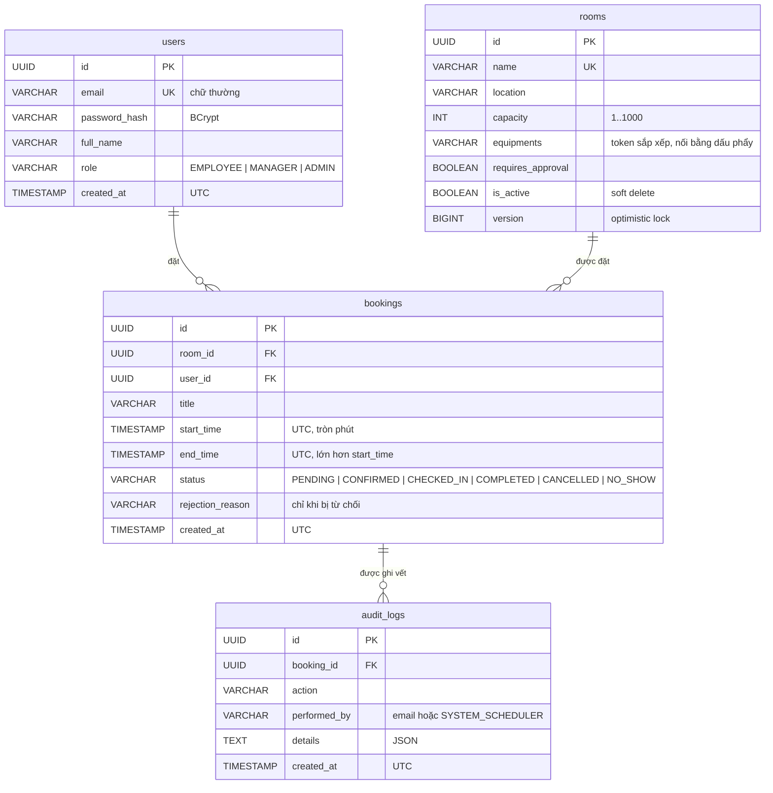

Điểm kỹ thuật đáng chú ý (`docs/contract/schema.sql`):
- **Composite index** `(room_id, status, start_time, end_time)` cho truy vấn kiểm tra trùng.
- **Exclusion constraint** `ex_bookings_no_overlap` (`EXCLUDE USING gist`, extension `btree_gist`): lớp chặn cuối ở tầng DB, không cho hai booking đang chiếm chỗ của cùng một phòng giao nhau.
- `rooms.version` dùng cho optimistic locking.

## 4. Vòng đời booking (State machine)

Mỗi trạng thái là một class (State pattern). Cặp (trạng thái, hành động) không hợp lệ trả 409 `INVALID_STATE_TRANSITION`.

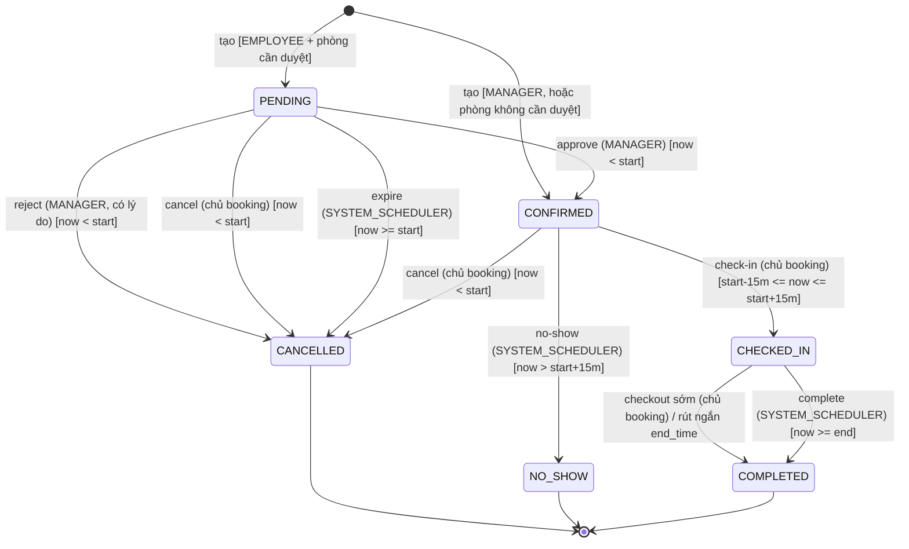

| Từ | Hành động | Ai | Điều kiện (sai thì lỗi) | Sang | Audit |
|---|---|---|---|---|---|
| — | create | EMPLOYEE, MANAGER | phòng active (404), không ở quá khứ (400), policy (400), không trùng (409) | PENDING / CONFIRMED | CREATED |
| PENDING | approve | MANAGER | `now < start` (409 `BOOKING_ALREADY_STARTED`) | CONFIRMED | APPROVED |
| PENDING | reject | MANAGER | lý do 1–255 ký tự; `now < start` | CANCELLED | REJECTED |
| PENDING / CONFIRMED | cancel | chủ booking | `now < start` | CANCELLED | CANCELLED |
| PENDING | expire | SYSTEM_SCHEDULER | `now >= start` | CANCELLED | EXPIRED |
| CONFIRMED | check-in | chủ booking | trong cửa sổ ±15 phút (409 `OUTSIDE_CHECKIN_WINDOW`) | CHECKED_IN | CHECKED_IN |
| CONFIRMED | no-show | SYSTEM_SCHEDULER | `now > start + 15m` | NO_SHOW | NO_SHOW |
| CHECKED_IN | checkout | chủ booking | — | COMPLETED | CHECKED_OUT |
| CHECKED_IN | complete | SYSTEM_SCHEDULER | `now >= end` | COMPLETED | COMPLETED |

## 5. Quy tắc nghiệp vụ

**Kiểm tra trùng giờ.** Booking mới `[S_new, E_new)` trùng với booking cũ `[S_old, E_old)` cùng phòng khi:

```
S_new < E_old  AND  E_new > S_old      (booking cũ ở PENDING, CONFIRMED hoặc CHECKED_IN)
```

Hai khung nối tiếp nhau (09:00–10:00 và 10:00–11:00) **không** trùng. CANCELLED, NO_SHOW, COMPLETED không chiếm chỗ.

**Policy theo vai trò (Strategy).**

| Policy | Thời lượng tối đa | Trạng thái ban đầu |
|---|---|---|
| `EmployeePolicy` | 120 phút (tính cả 120), quá thì 400 `DURATION_EXCEEDED` | `PENDING` nếu phòng cần duyệt, ngược lại `CONFIRMED` |
| `ManagerPolicy` | không giới hạn | `CONFIRMED` |

**Thời gian.** Giờ phải tròn phút, `end > start`, `start` không được trước phút hiện tại (400 `START_IN_PAST`). `Clock` được inject để test điều khiển được thời gian.

**Trả phòng sớm.** `end_time = min(end, max(start + 1m, now làm tròn lên phút))`; phần thời gian dư được giải phóng ngay để người khác đặt.

**Phòng.** Tên duy nhất (409 `ROOM_NAME_ALREADY_EXISTS`). Thiết bị là các token `^[a-z0-9-]{1,24}$`, tối đa 20, lọc theo khớp nguyên token (`tv` không khớp `tvbox`). Vô hiệu hóa phòng còn booking tương lai → 409 `ROOM_HAS_FUTURE_BOOKINGS`. Phòng inactive bị ẩn và không đặt được với người không phải ADMIN (404).

**Thứ tự kiểm tra lỗi.** 401 → 403 vai trò → 400 dữ liệu → 404 → 403 chủ sở hữu → 409. Mọi lỗi trả về ProblemDetail (RFC 7807) có trường `code`; lỗi 500 không lộ stack trace.

## 6. Chống đặt trùng đồng thời

Ba lớp bảo vệ khi tạo booking:

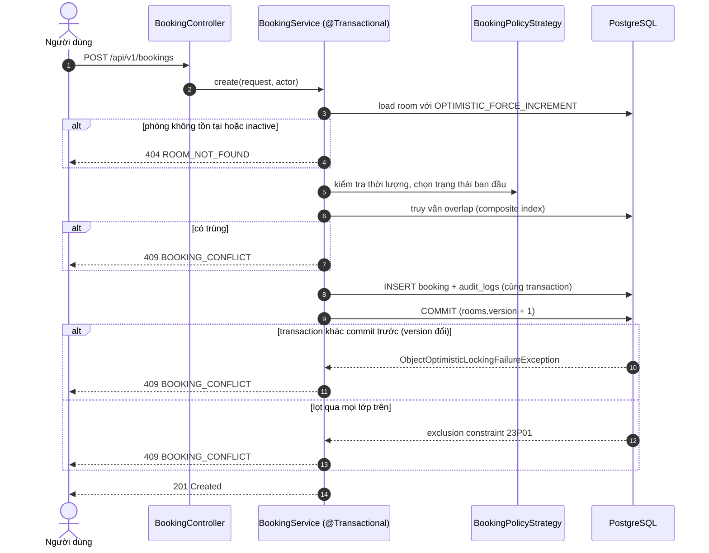

1. **Optimistic lock trên phòng**: mỗi lần tạo booking tăng `rooms.version`; hai request đồng thời cho cùng phòng thì chỉ một commit được.
2. **Truy vấn overlap** trong transaction.
3. **Exclusion constraint** ở DB làm lớp chặn cuối.

**Chuyển trạng thái** (user và scheduler) khóa dòng booking bằng `PESSIMISTIC_WRITE` (`SELECT ... FOR UPDATE`, timeout 3 giây), rồi kiểm tra lại trạng thái trên dòng đã khóa. Request thứ hai sẽ thấy trạng thái mới và nhận 409 `INVALID_STATE_TRANSITION`; quá thời gian chờ khóa thì 409 `CONCURRENT_UPDATE`. Chuyển trạng thái không khóa phòng, nên không làm nghẽn việc đặt phòng.

Đã kiểm chứng bằng test: ≥ 10 luồng cùng đặt một phòng một khung giờ → đúng một 201, còn lại 409, đúng một dòng booking.

## 7. Sự kiện, audit log và cache

Observer pattern qua Spring Application Events tách việc ghi audit và xóa cache khỏi luồng nghiệp vụ chính.

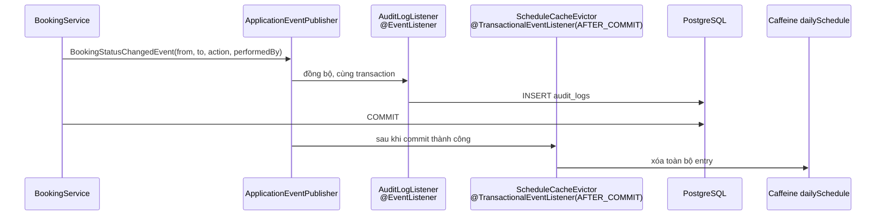

- **Audit:** mỗi lần chuyển trạng thái thắng ghi đúng một dòng `audit_logs`, `performed_by` là email người thực hiện hoặc `SYSTEM_SCHEDULER`, `details` là JSON `{"from","to"}` (thêm `reason` khi từ chối, `endTime` khi trả phòng sớm). Ghi cùng transaction nên không bao giờ có audit mồ côi.
- **Cache `dailySchedule`:** Caffeine, key là ngày, TTL 60 giây, tối đa 400 entry. Bị xóa **sau commit** khi có booking mới, mọi lần chuyển trạng thái (kể cả scheduler) và khi phòng thay đổi (`RoomChangedEvent`). Xóa sau commit thay vì `@CacheEvict` để reader không nạp lại dữ liệu cũ trước khi commit xong.
- **Hiệu năng:** `GET /bookings/daily-schedule` khi cache ấm có p95 < 50 ms (đo trong test với ≥ 50 booking). Truy vấn danh sách dùng `@EntityGraph` (room, user), số query không đổi giữa 5 và 50 booking, không có N+1.

## 8. Tác vụ nền (Scheduler)

`BookingScheduler` chạy `@Scheduled(fixedRate = 300000)` (mỗi 5 phút) với actor `SYSTEM_SCHEDULER`:

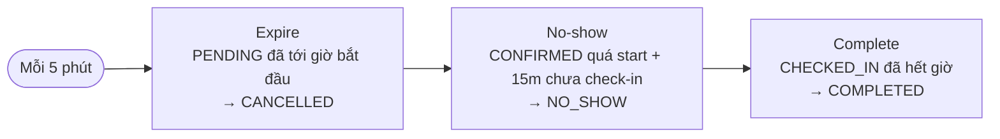

Mỗi booking xử lý trong transaction riêng: khóa dòng, kiểm tra lại điều kiện, bỏ qua nếu không còn đủ điều kiện. Lỗi ở một booking được log và không dừng cả lượt chạy. Tắt bằng `app.scheduler.enabled=false` (dùng trong test và profile `e2e`).

## 9. Bảo mật và phân quyền

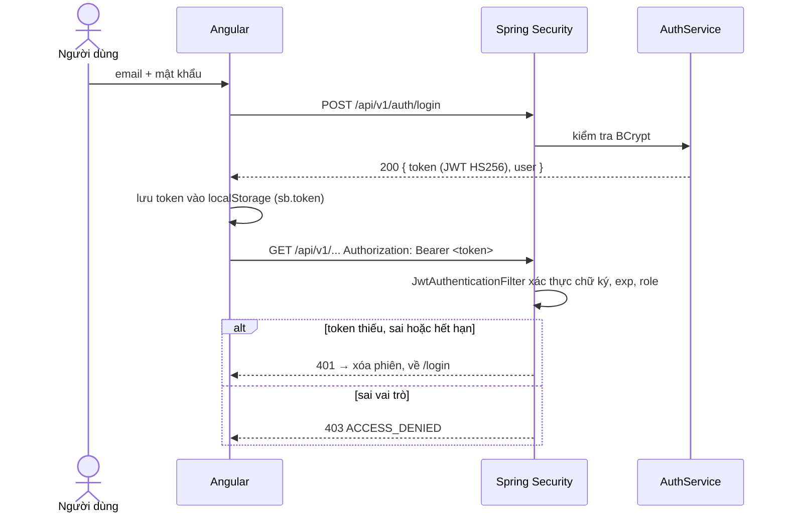

- Mật khẩu 8–72 ký tự, mã hóa BCrypt. Đăng ký luôn tạo EMPLOYEE; MANAGER và ADMIN chỉ tạo qua seeder.
- JWT HS256, claim `sub`, `email`, `role`, `exp`, thời hạn mặc định 8 giờ. `JWT_SECRET` ≥ 32 byte, bắt buộc ngoài profile `dev`/`e2e` (thiếu thì ứng dụng không khởi động).
- Đăng nhập sai trả cùng một thông báo cho email không tồn tại và sai mật khẩu (401 `INVALID_CREDENTIALS`).
- Luật vai trò đặt ở URL trong `SecurityConfig` (không dùng `@PreAuthorize`) để kiểm tra vai trò chạy **trước** validate body.
- CORS lấy từ `CORS_ALLOWED_ORIGINS`. `/v3/api-docs` tắt ở production.

**Ma trận phân quyền** (`[own]` = chỉ của mình, `[any]` = của bất kỳ ai):

| Endpoint | Chưa đăng nhập | EMPLOYEE | MANAGER | ADMIN |
|---|---|---|---|---|
| `POST /auth/register`, `/auth/login` | ✓ | ✓ | ✓ | ✓ |
| `GET /auth/me`, `GET /rooms`, `GET /bookings/daily-schedule` | 401 | ✓ | ✓ | ✓ |
| `GET /rooms?includeInactive=true` | 401 | 403 | 403 | ✓ |
| `POST/PUT/DELETE /rooms` | 401 | 403 | 403 | ✓ |
| `GET /bookings/my-bookings`, `POST /bookings` | 401 | ✓ | ✓ | 403 |
| `GET /bookings/pending`, `PATCH .../approve`, `.../reject` | 401 | 403 | ✓ [any] | 403 |
| `PATCH .../check-in`, `.../checkout`, `.../cancel` | 401 | ✓ [own] | ✓ [own] | 403 |
| `GET /bookings/{id}/logs` | 401 | ✓ [own] | ✓ [any] | ✓ [any] |
| `GET /audit-logs` | 401 | 403 | 403 | ✓ |

## 10. REST API

Base path `/api/v1`. Đặc tả đầy đủ (schema, mã lỗi, ví dụ): [`docs/contract/openapi.yaml`](docs/contract/openapi.yaml).

| Method | Path | Mô tả |
|---|---|---|
| POST | `/auth/register` | Đăng ký (EMPLOYEE), trả token + user |
| POST | `/auth/login` | Đăng nhập, trả token + user |
| GET | `/auth/me` | Thông tin người đang đăng nhập |
| GET | `/rooms` | Tìm phòng: `minCapacity`, `equipments`, `availableFrom`/`availableTo` |
| POST | `/rooms` | Tạo phòng (ADMIN) |
| GET / PUT / DELETE | `/rooms/{roomId}` | Xem, sửa, vô hiệu hóa (soft delete) phòng |
| POST | `/bookings` | Tạo booking |
| GET | `/bookings/daily-schedule?date=YYYY-MM-DD` | Lịch trong ngày của mọi phòng (có cache) |
| GET | `/bookings/my-bookings` | Booking của tôi (phân trang) |
| GET | `/bookings/pending` | Yêu cầu chờ duyệt (MANAGER, phân trang) |
| PATCH | `/bookings/{id}/approve` · `reject` · `check-in` · `checkout` · `cancel` | Chuyển trạng thái |
| GET | `/bookings/{id}/logs` | Lịch sử thao tác của một booking |
| GET | `/audit-logs` | Toàn bộ audit log (ADMIN, phân trang, lọc) |

Ví dụ lỗi (ProblemDetail):

```json
{
  "type": "about:blank",
  "title": "Conflict",
  "status": 409,
  "detail": "The room is already booked in this time range.",
  "instance": "/api/v1/bookings",
  "code": "BOOKING_CONFLICT"
}
```

## 11. Frontend

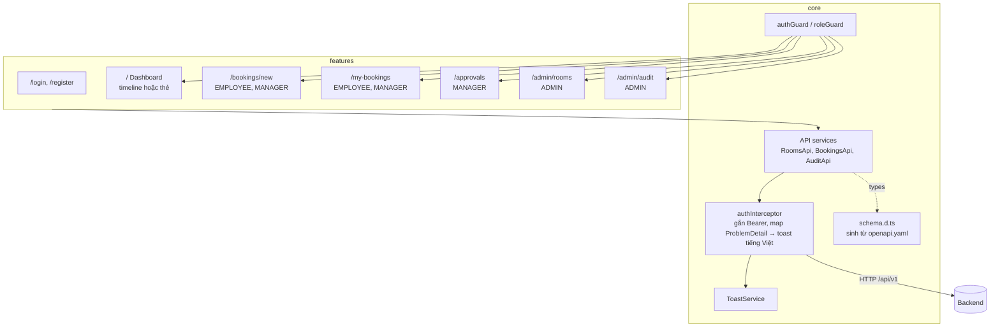

| Màn hình | Nội dung |
|---|---|
| Đăng nhập / Đăng ký | Form đơn giản ở giữa trang |
| Lịch tổng quan | Desktop (≥ 1024px): timeline CSS Grid 07:00–20:00, cột 30 phút, bấm ô trống để đặt nhanh, vạch "bây giờ", điều hướng bằng phím mũi tên. Mobile: dải 7 ngày + thẻ từng phòng với các khung trống và nút "Đặt nhanh" |
| Đặt phòng | Reactive Form, validator tùy chỉnh giờ kết thúc > giờ bắt đầu, gợi ý giới hạn 2 giờ cho nhân viên |
| Lịch của tôi | Bảng (desktop) hoặc thẻ (mobile), Check-in / Trả phòng / Hủy có xác nhận, phân trang |
| Phê duyệt | MANAGER duyệt hoặc từ chối (bắt buộc lý do) |
| Quản trị | CRUD phòng, bảng audit log có lọc |

- Kiểu DTO **không viết tay**: sinh từ OpenAPI bằng `openapi-typescript` (`npm --prefix frontend run gen:api`).
- Giờ hiển thị theo `Asia/Ho_Chi_Minh` bằng `Intl.DateTimeFormat`, không dùng thư viện ngày tháng.
- Design system ([`docs/design/DESIGN.md`](docs/design/DESIGN.md)): một màu chính teal, font Inter (subset tiếng Việt), icon Lucide inline SVG, trạng thái luôn có nhãn + icon (không chỉ dựa vào màu), mọi tương phản đạt WCAG AA, vùng chạm ≥ 44px trên mobile.

## 12. Kiểm thử

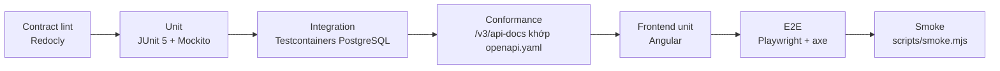

| Loại | Nội dung chính |
|---|---|
| Unit | Thuật toán overlap với `@ParameterizedTest` cho mọi ca biên, State × action matrix, policy (120 phút pass, 121 fail), scheduler tại đúng ranh giới |
| Integration | Qua HTTP thật với đầy đủ security chain trên PostgreSQL thật (Testcontainers): ma trận phân quyền mọi endpoint × mọi vai trò, IDOR, đồng thời (≥ 10 luồng), N+1, cache, hiệu năng |
| Conformance | So `/v3/api-docs` sinh ra với `docs/contract/openapi.yaml` (path, status, schema, enum); lệch là build fail |
| Coverage | JaCoCo gate ≥ 80% line trên `*.service` và `*.domain`. Đạt: 96.2% line, 87.7% branch toàn backend |
| Frontend unit | Validator, interceptor map lỗi, guard, map trạng thái → badge |
| E2E | Desktop 1280×800 và mobile 390×844, mọi thao tác qua UI: phân quyền route, đặt phòng, luồng duyệt / từ chối, xung đột hai trình duyệt, giới hạn 2 giờ, check-in, trả phòng sớm, NO_SHOW, hủy, quản trị phòng, kiểm tra a11y bằng axe |

Profile `e2e` bật các endpoint `/test-support/reset`, `/test-support/clock`, `/test-support/run-scheduler` để reset dữ liệu và điều khiển đồng hồ. Ở profile mặc định các endpoint này không tồn tại (có test xác nhận).

CI (`.github/workflows/ci.yml`) chạy 3 job: backend (contract lint + verify), frontend (lint, test, build production), e2e.

## 13. Chạy dự án ở máy local

**Yêu cầu:** JDK 21 (`JAVA_HOME` trỏ tới JDK 21), Node.js ≥ 22.14, Docker. Các lệnh dưới đây chạy từ thư mục gốc, trên PowerShell.

```powershell
# 1. Database
docker compose up -d postgres

# 2. Backend (profile dev: có sẵn JWT secret dev, seed dữ liệu, bật api-docs) → http://localhost:8080
.\backend\mvnw.cmd -f backend\pom.xml spring-boot:run '-Dspring-boot.run.profiles=dev'

# 3. Frontend → http://localhost:4200 (proxy /api sang 8080)
npm --prefix frontend ci
npm --prefix frontend start
```

**Tài khoản demo** (profile `dev`/`e2e`):

| Email | Vai trò | Mật khẩu |
|---|---|---|
| admin@spacebooking.local | ADMIN | `Admin@12345` |
| manager@spacebooking.local | MANAGER | `Manager@12345` |
| employee@spacebooking.local | EMPLOYEE | `Employee@12345` |

**Phòng mẫu:** Phòng Sen (6 người), Phòng Mai (4), Phòng Cúc (2), Phòng Trường Sơn (12, cần duyệt), Hội trường Bạch Đằng (40, cần duyệt).

**Lệnh kiểm tra:**

| Việc | Lệnh |
|---|---|
| Lint contract | `npx @redocly/cli lint docs/contract/openapi.yaml` |
| Backend test + coverage | `.\backend\mvnw.cmd -q -f backend\pom.xml verify` |
| Một test backend | `.\backend\mvnw.cmd -q -f backend\pom.xml test '-Dtest=<Class>'` |
| Build frontend | `npm --prefix frontend run build '--' --configuration production` |
| Lint frontend | `npm --prefix frontend run lint` |
| Test frontend | `npm --prefix frontend test '--' --watch=false` |
| E2E (tự khởi động Postgres, backend profile `e2e`, frontend) | `npm --prefix e2e test` |
| Smoke HTTP | `node scripts/smoke.mjs` |

Biến môi trường: xem [`.env.example`](.env.example). Không commit file `.env`.

## 14. Triển khai (Neon + Render + Vercel)

Thực hiện thủ công, không commit secret.

**1. Neon (PostgreSQL 16).** Tạo project và database. Flyway tự tạo schema ở lần khởi động đầu.
- `DB_URL=jdbc:postgresql://<host>/<db>?sslmode=require` (dạng JDBC, không dùng URL `postgres://`)
- `DB_USER`, `DB_PASSWORD` lấy từ role của Neon.

**2. Render (backend).** New Web Service, runtime Docker, root directory `backend/` (dùng `backend/Dockerfile` multi-stage, chạy user non-root, đọc `PORT` của Render). Biến môi trường:

| Biến | Giá trị |
|---|---|
| `SPRING_PROFILES_ACTIVE` | để trống (không bao giờ `dev` hay `e2e` ở production) |
| `JWT_SECRET` | ngẫu nhiên, ≥ 32 byte (vd. `openssl rand -base64 48`) |
| `JWT_TTL` | mặc định `8h` |
| `API_DOCS_ENABLED` | `false` |
| `CORS_ALLOWED_ORIGINS` | origin Vercel, vd. `https://spacebooking.vercel.app` (không có `/` cuối) |
| `DB_URL`, `DB_USER`, `DB_PASSWORD` | từ bước 1 |
| `SEED_ENABLED` | `false` |

**ADMIN đầu tiên:** seeder là cách duy nhất tạo ADMIN. Deploy một lần với `SEED_ENABLED=true` cùng `SEED_ADMIN_PASSWORD`, `SEED_MANAGER_PASSWORD`, `SEED_EMPLOYEE_PASSWORD` là mật khẩu mạnh (seeder cũng tạo 2 user demo và 5 phòng mẫu). Đăng nhập `admin@spacebooking.local`, chỉnh những gì cần, rồi đặt lại `SEED_ENABLED=false` và xóa 3 biến mật khẩu.

**3. Vercel (frontend).** Import repo, root directory `frontend/`. `frontend/vercel.json` đã cấu hình build command, thư mục output `dist/spacebooking/browser` và SPA fallback. Thay host giữ chỗ `spacebooking-api.onrender.com` trong rewrite `/api/(.*)` bằng host Render thật, rồi redeploy.

**Kiểm tra sau deploy:**
- `GET https://<render-host>/v3/api-docs` trả 404 (api-docs đã tắt).
- Mở URL Vercel và đăng nhập; lỗi CORS nghĩa là `CORS_ALLOWED_ORIGINS` chưa khớp.
- Render gói miễn phí ngủ khi rảnh: request đầu tiên sau đó mất khoảng 1 phút.

**Giới hạn đã biết:**
- Caffeine là cache trong từng instance: chạy nhiều instance Render thì lịch ngày có thể cũ tới 60 giây.
- JWT stateless, không có danh sách thu hồi: đổi vai trò chỉ có hiệu lực khi token hết hạn (tối đa `JWT_TTL`).

## 15. Cấu trúc thư mục và tài liệu

```
.
├── backend/            Spring Boot API (package-by-feature com.spacebooking.<feature>)
│   └── src/main/resources/db/migration/   Flyway V1__init.sql
├── frontend/           Angular SPA (core/, features/, shared/)
├── e2e/                Playwright tests (desktop + mobile, axe)
├── scripts/smoke.mjs   Smoke test HTTP hộp đen
├── docker-compose.yml  PostgreSQL 16 cho dev
├── .github/workflows/  CI
└── docs/
    ├── SpaceBooking.md         Đặc tả gốc (tiếng Việt)
    ├── PLAN.md, PROGRESS.md    Kế hoạch theo phase và tiến độ
    ├── contract/               Contract đóng băng: schema.sql, openapi.yaml,
    │                           domain.md, test-plan.md, DECISIONS.md
    ├── design/DESIGN.md        Design tokens và layout
    └── diagrams/               erd.mmd, state.mmd (Mermaid)
```

| Tài liệu | Dùng khi |
|---|---|
| [`docs/SpaceBooking.md`](docs/SpaceBooking.md) | Muốn đọc yêu cầu gốc |
| [`docs/contract/domain.md`](docs/contract/domain.md) | Cần luật nghiệp vụ chính xác (trạng thái, khóa, cache, phân quyền) |
| [`docs/contract/openapi.yaml`](docs/contract/openapi.yaml) | Cần shape request/response và mã lỗi |
| [`docs/contract/DECISIONS.md`](docs/contract/DECISIONS.md) | Muốn biết vì sao một quyết định được chọn |
| [`docs/contract/test-plan.md`](docs/contract/test-plan.md) | Tra test nào bao phủ luật nào |
| [`docs/design/DESIGN.md`](docs/design/DESIGN.md) | Sửa giao diện |
